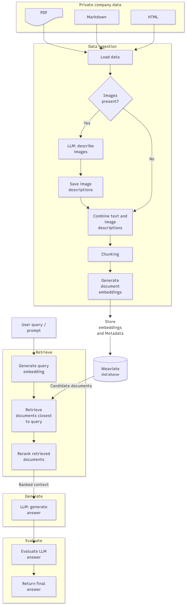

# checkpoint-rag

# The goal of this project is to solve the problem ahead using RAG.

## Scenario
You have been hired as the first AI engineer at a 200-person SaaS company. The Customer Success
team handles ~400 support tickets per day, and every senior CSM spends roughly 90 minutes per day
searching internal documentation, runbooks, and post-mortems to answer questions they have
answered before.

## The Data
The initial data is a mixed of formats like PDFs, markdown, HTML pages, where the map ish of those docs are
roughly  
• ~60 product documentation files (Markdown)
• ~25 internal runbooks (PDF, some scanned, some text-native)
• ~15 resolved support tickets with resolutions (HTML)

## The stack of the project

- Python 3.14.4
- Ollama
    - Embedding model: embeddinggemma-2
    - LLM model: qwen3:30b
- LangChain 
- Pytest
- RAGAs 
- Weaviate

## Repository structure 

├── pyproject.toml
├── .env.example # Document required env vars (no real keys)
├── src/
│ ├── ingest.py # Loads, chunks, embeds, indexes
│ ├── retrieve.py # Retriever with your chosen improvement
│ ├── generate.py # LCEL chain → structured response
│ └── pipeline.py # End-to-end: query → answer
├── evals/
│ ├── harness.py # Runs eval set, writes results
│ ├── test_set.json # The 50 provided queries
│ └── results/ # Output directory (committed empty)
├── tests/
│ ├── test_ingest.py
│ ├── test_retrieve.py
│ ├── test_generate.py
│ └── test_evals.py

## Architecture

• Chunking strategy section:
    ...

• Retrieval strategy section:
    ...
    
• Generation prompt:
    ...

• Eval results table: 
    faithfulness, answer relevance, context precision.

• How to run: 
    clone ->
    install ->
    set env vars -> 
    ingest ->
    run query ->
    run evals ->

• What´s comming next? 
